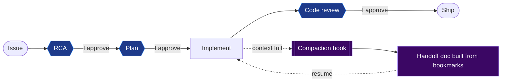

<!-- ═══════════════════════════ HEADER ═══════════════════════════ -->
<p align="center">
  
</p>

<p align="center">
  <a href="https://github.com/TarunRaveesh">
    
  </a>
</p>

<p align="center">
  <a href="https://linkedin.com/in/tarun-raveesh"></a>
  <a href="https://x.com/TranceX07"></a>
  <a href="mailto:tarunraveesh07@gmail.com"></a>
  
</p>

---

## ⚡ whoami

```powershell
PS C:\> Get-CimInstance -Namespace root\dev -ClassName Engineer_Profile | Format-List

Name       : Tarun Raveesh
Role       : Software Engineer @ Zoho Corporation (ManageEngine)
Builds     : The Windows agent behind Endpoint Central / UEMS
Focus      : Endpoint management, software asset management, inventory scanning
Internals  : Win32, WMI/CIM, COM/DCOM, Windows Installer, Registry, Kernel mode
Workflow   : Agentic development with Claude Code, human approval at every gate
Off-hours  : Chess (~1800 blitz/rapid), singing
Status     : OK
```

## 🛠️ What I work on

- 🔭 Building the **ManageEngine Windows agent**: inventory scans and software asset management across large enterprise fleets.
- 🧠 Living close to the OS: **Win32, WMI/CIM, Windows Installer, the registry, Group Policy, AppLocker**, and kernel-mode code when user mode is not enough.
- 🤖 Running an **AI-native dev workflow**: custom agent skills, hooks, and hard human gates between RCA, plan, code, and review.
- 📓 Keeping a portable, AI-agnostic engineering notebook of every lesson worth keeping.

## 🕳️ Rabbit holes I've been down

| Topic | The short version |
|---|---|
| 🗂️ Add/Remove Programs | It is a display layer, not the source of truth for what is installed |
| 🔀 Packed ("squished") GUIDs | How Windows Installer stores ProductCodes and UpgradeCodes in the registry |
| 🧱 `Get-WmiObject` vs `Get-CimInstance` | And the CIM → WMI → COM/DCOM stack under both |
| 👥 `Win32_SystemUsers` vs `Win32_UserAccount` | Why two "user" classes disagree, and which one an agent should trust |
| 🔐 Headless per-user uninstalls | `LogonUser` → `LoadUserProfile` → `CreateProcessAsUser` |
| 🛡️ AppLocker / SRP at scale | Rollouts and debugging across enterprise endpoints |
| 🐛 Git Bash `fork()` failures | Root cause: Mandatory ASLR in Windows Exploit Protection |

## 🤖 How I build in the AI era

AI writes a lot of code now. My job is to own the judgment. Every change goes through explicit approval gates, and long sessions survive context compaction through an automatic handoff.



## 🧰 Toolbox

**Systems & Windows**

<p>
  
</p>

<p>
  
  
  
  
  
  
  
  
</p>

**AI-native workflow**

<p>
  
  
  
  
</p>

**Web & Web3** (where I started)

<p>
  
</p>

<!--
  Want project cards? Add one line per repo:
  <a href="https://github.com/TarunRaveesh/REPO"></a>
-->

## 📊 GitHub Stats

<p align="center">
  <picture>
    <source media="(prefers-color-scheme: dark)" srcset="https://github-stats-extended.vercel.app/api?username=TarunRaveesh&show_icons=true&hide_border=true&theme=tokyonight" />
    
  </picture>
  <picture>
    <source media="(prefers-color-scheme: dark)" srcset="https://github-stats-extended.vercel.app/api/top-langs/?username=TarunRaveesh&layout=compact&hide_border=true&theme=tokyonight" />
    
  </picture>
</p>

<p align="center">
  <picture>
    <source media="(prefers-color-scheme: dark)" srcset="https://streak-stats.demolab.com?user=TarunRaveesh&theme=dark&hide_border=true" />
    
  </picture>
</p>

<!-- Needs .github/workflows/snake.yml in this repo (run it once from the Actions tab) -->
<p align="center">
  <picture>
    <source media="(prefers-color-scheme: dark)" srcset="https://raw.githubusercontent.com/TarunRaveesh/TarunRaveesh/output/github-contribution-grid-snake-dark.svg" />
    
  </picture>
</p>

---

<p align="center">
  <b>Open to collaborating on Windows tooling, endpoint security, and agentic dev workflows.</b><br/>
  <sub>Say hi: <a href="mailto:tarunraveesh07@gmail.com">tarunraveesh07@gmail.com</a></sub>
</p>

<p align="center">
  
</p>
