<picture>
  <source media="(prefers-color-scheme: dark)" srcset="./assets/header-dark.svg">
  
</picture>

 

I build the Windows agent behind **ManageEngine Endpoint Central** at Zoho: the code that scans, inventories, and manages software across enterprise fleets. Most of my time goes into Win32, WMI/CIM, Windows Installer, and the registry, with kernel mode when user mode is not enough.

 

<picture>
  <source media="(prefers-color-scheme: dark)" srcset="./assets/workflow-dark.svg">
  
</picture>

AI agents write many of my first drafts. The judgment stays mine: nothing passes root cause, plan, or review without my sign-off, and long sessions survive context compaction through an automatic handoff doc.

### Now

- Inventory scanning and software asset management for the ManageEngine agent
- Agent skills and hooks that keep long Claude Code sessions coherent
- A portable, AI-agnostic notebook of every lesson worth keeping

### Stack

`C` `C++` `PowerShell` `Python` `Win32` `WMI / CIM` `COM` `Windows Installer` `Registry` `Kernel mode` `Claude Code` `MCP`

<b>Rabbit holes</b>

 

- Why Add/Remove Programs is a display layer, not the source of truth
- Packed GUIDs, and how Windows Installer maps UpgradeCodes in the registry
- `Win32_SystemUsers` vs `Win32_UserAccount`, and which one an agent should trust
- Headless per-user uninstalls: `LogonUser` → `LoadUserProfile` → `CreateProcessAsUser`
- A Git Bash `fork()` failure, traced to Mandatory ASLR

 

[LinkedIn](https://linkedin.com/in/tarun-raveesh) &nbsp;·&nbsp; [X](https://x.com/TranceX07) &nbsp;·&nbsp; [Email](mailto:tarunraveesh07@gmail.com)

Off the keyboard: chess (~1800 blitz and rapid) and singing.
